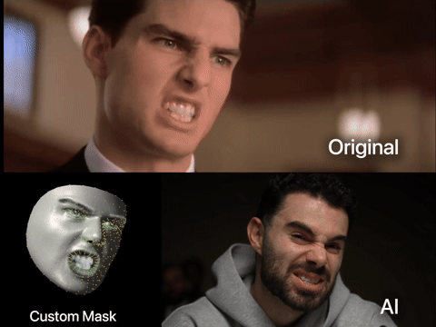
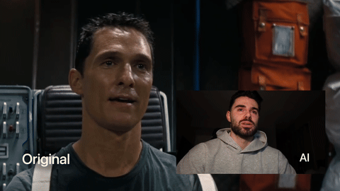
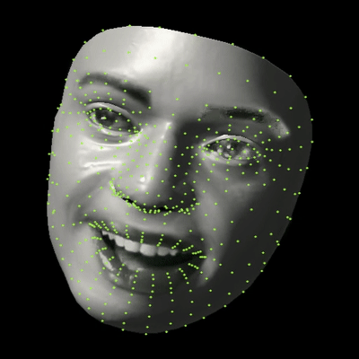
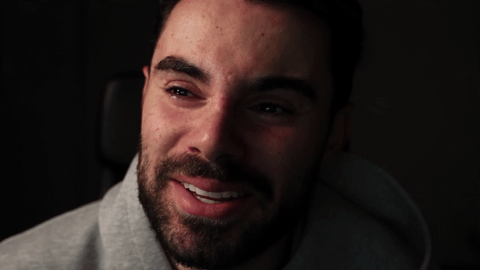
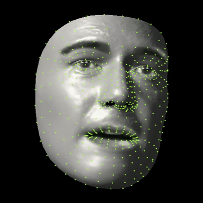
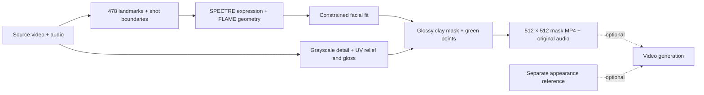

<p align="center">
  <a href="https://tein.ai"></a>
</p>

<h1 align="center">Emotion Control</h1>
<p align="center"><strong>A performance starts with a face. Keep the expression. Change the appearance.</strong></p>
<p align="center">Sirio's final glossy clay mask workflow — tracked motion, fitted geometry, source detail, and 478 green points.</p>
<p align="center"><a href="https://tein.ai"><strong>Join the TEIN AI waitlist →</strong></a> · <a href="docs/SETUP.md">Setup</a> · <a href="docs/SETUP-AGENT.md">Set up with an agent</a> · <a href="#the-masks">Mask gallery</a> · <a href="#license">License</a></p>

<p align="center"><strong>Want more open-source AI filmmaking workflows?</strong><br>Join the TEIN AI waitlist for updates on new workflows, tools, and releases.<br><a href="https://tein.ai"><strong>Join the waitlist at tein.ai →</strong></a><br><a href="https://www.skool.com/publicai"><strong>Join our free community →</strong></a></p>

## See the performance transfer

Two supplied examples. Click a GIF to open the full MP4 with sound.

### Courtroom performance

[](examples/videos/courtroom-preview.mp4)

[Watch full example ↗](examples/videos/courtroom-preview.mp4)

### Emotional performance

[](examples/videos/emotional-performance.mp4)

[Watch full example ↗](examples/videos/emotional-performance.mp4)

The generated appearances are demonstration results from a separate generation step. This repository builds the performance masks; it does not bundle a video-generation model or make paid API calls.

## The masks

Two actual extracted masks: the smiling-man performance and the emotional-reaction performance. GIFs are silent excerpts; full MP4s retain source audio. The full mask clips and edited example videos can have different durations.

### Expressive performance — original → mask → Sirio

The matching original is the source recorded in this mask's run manifest. The generated result is the supplied Seedance video. These previews show the crying section near the end of the performance.

**Original performance**

[](examples/videos/expressive-original.mp4)

[Watch original video ↗](examples/videos/expressive-original.mp4)

**Tracked mask**

[](examples/masks/expressive-mask.mp4)

[Download mask MP4 ↗](examples/masks/expressive-mask.mp4)

**Sirio — generated result**

[](examples/videos/expressive-sirio.mp4)

[Watch Sirio's video ↗](examples/videos/expressive-sirio.mp4)

### Emotional mask — transition into crying

[](examples/masks/emotional-mask.mp4)

[Download mask MP4 ↗](examples/masks/emotional-mask.mp4)

## One pipeline



- **Expression timing:** per-frame lips and eyelids, with temporal context isolated at cuts.
- **Readable detail:** grayscale source eyes and mouth, UV-derived crease shading and gloss.
- **The final material:** 84% clay on skin, 10% in protected features, directional light and clear coat.
- **Useful exports:** isolated mask, source/mask comparison, detail/material comparison, validation report.

This is the approved `approved-sculpted-glossy-v1` implementation. The public package only changes executable discovery and setup; the fitting and material math are preserved. See [provenance and validation](docs/PROVENANCE.md).

Full implementation map: [tech stack, every processing stage, and every material layer](docs/TECHNICAL-STACK.md).

## Get started

Python 3.12, FFmpeg, and separately obtained model assets are required. Follow the [complete setup guide](docs/SETUP.md) first. FLAME and SPECTRE have research/noncommercial restrictions; the wrapper's MIT license does not override them.

```bash
git clone https://github.com/sirioberati/Emotion-Control-Open-Source-Workflow.git
cd Emotion-Control-Open-Source-Workflow
python3.12 -m venv .venv
source .venv/bin/activate
python -m pip install -r requirements.txt
python tools/fetch_public_assets.py
# Obtain FLAME 2020 and SPECTRE weights using docs/SETUP.md.
python tools/prepare_assets.py
python tools/check_setup.py
python run.py "/absolute/path/to/your-source.mp4" \
  --start 4 --duration 3 --output outputs/pilot
```

Use a raw performance video as input, not the supplied comparison montages. Review the pilot, then process the full clip into a new folder:

```bash
python run.py "/absolute/path/to/your-source.mp4" --output outputs/full
```

For unchanged interrupted runs, repeat the command with `--resume`. Changed source, trim, settings or code require a **new output folder**.

### Set up with your coding agent

Give your agent this prompt from the cloned repository:

> Read docs/SETUP-AGENT.md and docs/SETUP.md. Set up this exact approved mask pipeline. Preserve the fitting and rendering math. Check the model licenses and ask me for missing licensed assets. Run a short pilot from my raw video and verify the mask and audio before a full run.

## Files you get

| Output | Purpose |
| --- | --- |
| `Sculpted-3D-mask.mp4` | Isolated 512 × 512 glossy clay face, 30 fps, source audio when present |
| `Original-and-sculpted-3D.mp4` | Synchronized 1024 × 568 comparison |
| `Detailed-vs-sculpted-3D.mp4` | Compare source detail with the final material |
| `Validation.json` | Frame count, dimensions, frame rate, duration and audio checks |
| `_work/` | Tracking, maps and intermediate geometry for review |

Native mask resolution is 512 square. Upscaling does not recover extra facial detail.

## Practical limits

One face is tracked per frame; automatic identity continuity between different people is not implemented. Cuts are detected heuristically. Review blinks, lip closure, occlusion, extreme head angles and fast motion. A low fitting residual is not independent proof of tracking accuracy.

The material includes source pixels and estimated surface detail. It can retain likeness; it is not anonymization, a measured skin scan, or calibrated emotion detection. Long clips can use substantial RAM for intermediate frame stacks.

## More open-source workflows from TEIN AI

Want more workflows like Emotion Control? Join the TEIN AI waitlist for updates on new open-source AI filmmaking workflows, tools, and releases.

**[Join the TEIN AI waitlist →](https://tein.ai)**

Connect with other creators in our free community: **[Join Public AI on Skool →](https://www.skool.com/publicai)**

Also explore [Genjustsu — Open Source Workflow](https://github.com/sirioberati/Genjustsu-Open-Source-Workflow).

## License

The TEIN wrapper code and documentation are [MIT licensed](LICENSE). Third-party code, models and assets retain their own terms. **FLAME 2020 is restricted to noncommercial scientific research; SPECTRE is CC BY-NC-SA 4.0.** The complete stack is not an unrestricted commercial-use license.

TEIN branding and example media are excluded from the code license. See [third-party notices](THIRD_PARTY_NOTICES.md) and [example details](examples/README.md).
